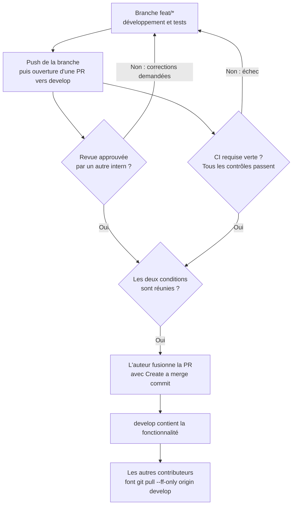

# Git simple — équipe de deux interns

## Branches

- `main` : version stable ; `develop` : intégration du travail.
- Chaque intern crée une branche temporaire `feat/` par fonctionnalité, depuis `develop`.
- Ouvrir une PR vers `develop`. Un autre intern relit ; fusionner après approbation et CI verte avec **Create a merge commit**.
- Ne jamais pousser directement sur `develop` ou `main`.

## Première configuration

Si `develop` n'existe pas, un intern la crée une seule fois depuis `main` :

```bash
# Basculer sur la branche principale.
git switch main
# Mettre à jour main depuis le dépôt distant, sans créer de commit de fusion.
git pull --ff-only origin main
# Créer develop à partir de main et s'y placer.
git switch -c develop
# Publier develop et configurer le suivi de la branche distante.
git push -u origin develop
```

Si `develop` existe déjà, récupérer la branche :

```bash
# Télécharger les références des branches distantes.
git fetch origin
# Créer develop localement en suivant la branche distante.
git switch -c develop --track origin/develop
```

## Pour chaque fonctionnalité

Créer sa branche temporaire depuis la version à jour de `develop` :

```bash
# Se placer sur develop.
git switch develop
# Récupérer la dernière version de develop.
git pull --ff-only origin develop
# Créer une branche de fonctionnalité et s'y placer.
git switch -c feat/123-student-course
```

Faire une petite fonctionnalité, tester, puis publier :

```bash
# Sélectionner les modifications à inclure.
git add -p
# Enregistrer les modifications avec un message clair.
git commit -m "feat(student): add beginner course"
# Publier la branche et configurer son suivi distant.
git push -u origin feat/123-student-course
```

Sur GitHub, ouvrir une PR `feat/123-student-course` → `develop`, demander une revue à un autre intern, puis fusionner avec **Create a merge commit** après approbation et CI verte.



La **CI** (intégration continue) exécute automatiquement les vérifications configurées pour la PR, par exemple les tests et le build. « Verte » signifie que toutes les vérifications requises ont réussi ; un contrôle en échec doit être corrigé avant la fusion. L'approbation de la revue et la CI verte sont deux conditions distinctes : il faut les deux.

Après la fusion, supprimer la branche temporaire locale et distante :

```bash
# Revenir sur develop avant de supprimer la branche de travail.
git switch develop
# Mettre à jour develop après la fusion.
git pull --ff-only origin develop
# Supprimer la branche locale déjà fusionnée.
git branch -d feat/123-student-course
# Supprimer la branche distante (ou utiliser le bouton Delete branch dans GitHub).
git push origin --delete feat/123-student-course
```

Remplacer `123-student-course` par l'identifiant et le nom de la tâche. Si un conflit apparaît, le résoudre avec l'autre intern ; ne pas forcer le push. Garder une fonctionnalité par PR et éviter de modifier simultanément les mêmes fichiers.

## Release et qualité

- Quand `develop` est testée, les deux interns relisent la PR `develop` → `main`.
- Vérifier les validations concernées : frontend (`npm run build`), backend (`php artisan test`) et API réelle (`VITE_USE_MOCK=false`) si le flux touche l'API.
- Une PR = une fonctionnalité définie, avec tests/résultats. Ne jamais inclure de secret ou fichier `.env` réel.
- Ne jamais modifier une migration déjà fusionnée : ajouter une migration forward-only et la tester sur une base propre.
- Préserver l'idempotence et les invariants append-only de `xp_ledger` et `germes_ledger`.
