# Audit de Pré-Production & Rapport de Diagnostic Technique
# Plateforme "Code212 Quest" — Centre CODE212 (Université Cadi Ayyad)

> **Date de l'audit :** 24 Novembre 2026  
> **Cible :** `Code212_Quest-V1.0` (React 18 / Vite / TypeScript + Laravel 11 / PostgreSQL 18)  
> **Objectif :** Mise en production pour plusieurs centaines d'étudiants concurrents (Équipe de 3 stagiaires)  
> **Mode de l'audit :** READ-ONLY (Aucune modification du code source effectuée)  

---

## 1. Executive Summary

### 1.1 Verdict Global
**Score global de préparation à la production : 2.5 / 10 (NON PRÊT POUR LA PRODUCTION)**

Bien que l'application présente une interface soignée en mode démonstration locale (`VITE_USE_MOCK=true`) et que les services métiers Laravel contiennent une logique transactionnelle solide (verrous pessimistes, journalisation d'audit, déclencheurs PostgreSQL pour les journaux append-only), **la plateforme est totalement inopérante de bout en bout en mode connecté (`VITE_USE_MOCK=false`)**. 

La cause première est un **décalage systématique et structurel à 100% entre le contrat de sérialisation du backend Laravel (clés snake_case en français, enveloppe `{data, meta}`) et les attentes du frontend React/TypeScript (clés camelCase en anglais, tableaux directs)**. À cela s'ajoutent des erreurs de compilation TypeScript bloquantes sur le frontend, des erreurs de syntaxe PHP bloquantes empêchant l'exécution des tests unitaires/fonctionnels, et plusieurs endpoints cruciaux manquants ou mal routés.

### 1.2 Scores de Préparation par Espace (0 – 10)

| Espace | Score | Diagnostic Sommaire |
|---|:---:|---|
| **Auth, Session & Onboarding** | **3.0 / 10** | Login par mot de passe fonctionnel avec adaptation ad hoc ; redirection SSO UCA pointant vers une route inexistante (`GET /api/v1/auth/uca`) ; déconnexion sans révocation serveur du jeton Sanctum ; URL API en dur dans `auth.tsx`. |
| **Espace Apprenant (Student)** | **3.5 / 10** | Fonctionnel en démo mock uniquement. En mode API réel, crash/écrans vides immédiats dus à l'enveloppe `{data}` non déballée et aux types anglais vs JSON français. Route `/certifications` inexistante côté Laravel. Dépôt de livrable rejeté par validation 422 (`content: string` vs `contenu: array`). Dépôt de solution d'Arène absent de l'UI. |
| **Espace Formateur (Trainer / Team)** | **1.5 / 10** | `team-overview-page.tsx` est une coquille statique avec des liens vers l'espace admin. File de correction appelant des endpoints non conformes (`/admin/submissions` au lieu de `/submissions`) et envoyant un statut invalide (`validee` au lieu de `approuvee`, déclenchant une 422). Déconnexion entre `quest_submissions` et `submissions`. |
| **Espace Modérateur (Moderator)** | **1.0 / 10** | Page de modération `admin-moderation-page.tsx` contenant du code purement factice (`void id`, toasts simulés sans appel API). Pas de gestion des bannissements effectifs depuis l'UI. |
| **Espace Administration (Admin)** | **2.5 / 10** | KPIs et analytics incompatibles avec la réponse Laravel. Modification de règle XP impossible via l'UI (`PATCH /admin/rules/xp/{id}` vs `PUT /admin/rules/xp`). Validation de commandes boutique impossible (`PATCH /admin/orders/{id}` vs `PATCH /orders/{order}/approve`). Export CSV étudiant fictif (`toast`). |
| **Espace Direction / Super-Admin** | **2.0 / 10** | Le build TypeScript échoue sur cet espace (imports inutilisés sous `noUnusedLocals`). Modération de La Forge câblée en simulation pure dans le `localStorage`. |
| **Socle Backend & Données** | **4.0 / 10** | Excellente conception théorique du journal append-only et des verrous de concurrence. Cependant : deux erreurs de syntaxe PHP empêchent PHPUnit de s'exécuter ; base de données PostgreSQL 18 arrêtée en local ; classe clé `Codep212ConfigService` avec faute de frappe propagée ; contrôleur Libki absent. |

### 1.3 Top 10 des Bloqueurs Majeurs (P0)

1. **Rupture contractuelle Frontend / Backend généralisée** : Toutes les `JsonResource` Laravel renvoient du français snake_case (`nom`, `niveau`, `germes`, `titre`, `voie`), alors que les types TypeScript `UserProfile`, `Quest`, `Reward`, `DashboardData`, etc. attendent de l'anglais camelCase (`firstName`, `level`, `germs`, `title`, `track`).
2. **Non-déballage de l'enveloppe `{ data, meta }` dans `api.ts`** : Le client HTTP Axios/Fetch renvoie l'objet racine `{ data: [...] }`. Les composants React appelant `.map()` ou `.filter()` lèvent des `TypeError` critiques.
3. **Échec de compilation Frontend (`npm run build`)** : Deux erreurs TypeScript `TS6133` bloquantes dans `director-identity-page.tsx:3` et `director-overview-page.tsx:12` interdisent tout déploiement de production.
4. **Erreurs de syntaxe PHP bloquant PHPUnit** : Espaces invalides dans les noms de méthodes de test dans `tests/Unit/ExampleTest.php:35` et `tests/Feature/LedgerIdempotencyTest.php:69`, empêchant le moteur de test de charger la moindre suite.
5. **Endpoint `/certifications` manquant dans Laravel** : Le composant `certifications-page.tsx` appelle `GET /certifications`, mais aucune table, aucun modèle, aucun contrôleur et aucune route n'existent dans l'API Laravel.
6. **Rejet systématique de la soumission d'étape (`POST /quests/{id}/steps/{step}/submit`)** : Le frontend transmet `{ content: string }`, alors que `SubmitStepRequest.php:25` exige obligatoirement `'contenu' => ['required', 'array']`. Erreur HTTP 422 garantie.
7. **Rupture du circuit d'approbation des livrables** : Le frontend appelle `GET /admin/submissions` et `POST /admin/submissions/{id}/review` avec `{ decision: 'validee' }`. L'API n'expose que `GET /submissions` et `POST /submissions/{id}/approve`, et n'accepte que `'approuvee'` ou `'rejetee'` (`ApproveSubmissionRequest.php:27`).
8. **Routing brisé pour l'administration des règles XP et des commandes** : Le frontend fait des requêtes PATCH avec identifiant dans l'URL (`/admin/rules/xp/{id}`, `/admin/orders/{id}`) qui se heurtent à des 404/405 car Laravel expose `PUT /admin/rules/xp` et `PATCH /orders/{order}/approve`.
9. **Flux SSO UCA (OIDC) non amorçable depuis l'interface** : `auth.tsx:198` redirige l'utilisateur vers `GET /api/v1/auth/uca`, alors que seule la route `POST /api/v1/auth/uca/callback` est déclarée dans `routes/api.php`.
10. **Déconnexion sans révocation serveur du jeton Sanctum** : `auth.tsx:201` supprime uniquement les clés de `localStorage`/`sessionStorage` sans jamais appeler `POST /api/v1/auth/logout`, laissant les jetons actifs indéfiniment en base.

---

## 2. Méthodologie & Niveau de Preuve

Toutes les affirmations de ce rapport sont appuyées par des faits vérifiés. Conformément aux directives d'audit, chaque constat est étiqueté :
- **VERIFIED (executed)** : Constaté par exécution d'une commande dans l'environnement système.
- **STATIC (read in code)** : Identifié par lecture statique rigoureuse du code source (fichier et ligne à l'appui).

### Outils & Environnement d'Exécution

```
OS : Linux 6.6.137+
Node.js : v22.22.1 (VERIFIED)
npm : 10.9.4 (VERIFIED)
PHP : 8.5.4 CLI (VERIFIED)
Composer : 2.9.5 (VERIFIED)
PostgreSQL Client : psql 18.6 (VERIFIED)
PostgreSQL Service (18/main port 5432) : Arrêté / down en sandbox (VERIFIED)
```

### Limites d'Exécution Rencontrées
- **Compilation Frontend** : `npm run build` a été exécuté dans `apps/web`. Résultat : **Échec (code 1)** avec 2 erreurs de compilation TypeScript identifiées.
- **Backend Composer** : `composer install` a été exécuté dans `apps/api`. Résultat : **Succès** (autoload généré, dépendances à jour).
- **Backend Routing** : `php artisan route:list` a été exécuté. Résultat : **58 routes chargées** (54 routes sous `/api/v1`).
- **Tests PHPUnit** : `php artisan test` a été exécuté. Résultat : **Échec fatal (code 255)** au parsing de `ExampleTest.php`.
- **Base de données PostgreSQL** : Le démon PostgreSQL `18/main` n'est pas démarré en tâche de fond dans l'environnement sandbox contraint. Les tests d'invariants exécutant des migrations réelles n'ont pas pu se connecter au port 5432. L'analyse du schéma SQL et des migrations a donc été complétée en inspection statique approfondie.

---

## 3. Architecture Trouvée vs Documentation

### 3.1 Vue d'Ensemble de l'Architecture Réelle

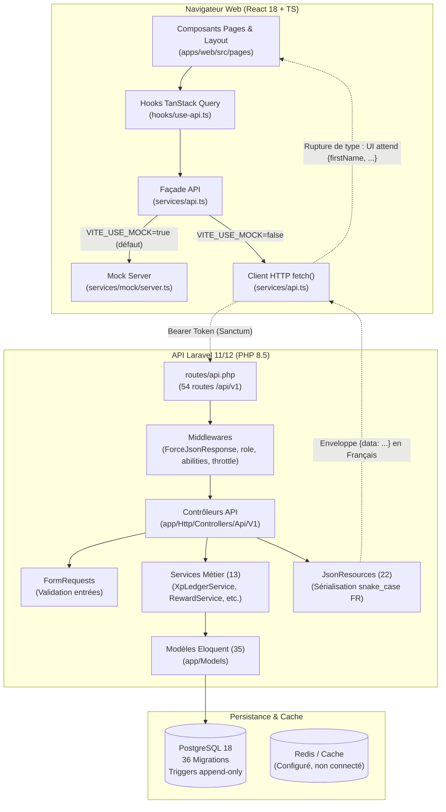

### 3.2 Tableau des Incohérences Documentation vs Réalité

| Sujet | Revendiqué dans la Documentation | Constaté dans le Code Source | Niveau de Preuve |
|---|---|---|---|
| **Nombre de routes API** | 60 routes (`ARCHITECTURE.md:91`, `README.md:34`) | **58 routes au total**, dont **54 routes sous `/api/v1`** | VERIFIED (`php artisan route:list`) |
| **Nombre de modèles** | 34 modèles (`ROADMAP.md:34`, `ARCHITECTURE.md:97`) | **35 modèles** dans `app/Models` (ajout de `ForgeThreadRead.php`) | VERIFIED (`ls app/Models/*.php \| wc -l`) |
| **Nombre de migrations** | 35 migrations (`ROADMAP.md:34`) | **36 migrations** (migration patch `2026_11_19_000001_extend_forge_activity.php`) | VERIFIED (`ls database/migrations/*.php \| wc -l`) |
| **Nombre de services** | 13 services (`ROADMAP.md:34`) | **13 services**, mais `Codep212ConfigService` comporte une faute de frappe dans le nom de classe et de fichier | VERIFIED (`ls app/Services/*.php`) |
| **Tests automatisés** | 8 tests (`ARCHITECTURE.md:34`) | **9 fichiers de tests** (8 Feature + 1 Unit), mais 2 comportent des erreurs de syntaxe PHP fatales | VERIFIED (`find tests -name "*.php"`) |
| **Contrôleur Libki** | "Table + contrôleur câblés" (`ROADMAP.md:45`) | **Table et modèle existants, aucun contrôleur, aucune route, aucun webhook** | STATIC (`grep -rn "Libki" apps/api`) |
| **Certifications** | Présenté comme écran et service API (`API_CONTRACT.md:88`, `api.ts:139`) | **Inexistant dans Laravel** (aucune table, aucune route, aucun contrôleur) | STATIC (`grep -rn "certif" apps/api`) |
| **Droit de vote La Forge** | Contradiction documentée : Niveau 3 vs Niveau 4 (`DECISIONS.md:169`) | **Inexistant dans l'API** : table `forge_votes` présente, mais zéro route, zéro contrôleur ; `api.ts:187` rejette avec HTTP 501 | STATIC (`api.ts:187`, `routes/api.php`) |
| **Réduction de mouvement** | À faire : `MotionConfig reducedMotion="user"` (`DESIGN_SYSTEM.md:209`) | **Déjà fait** dans `main.tsx:33-35` | STATIC (`main.tsx:33`) |
| **Typo Nom de Service** | Non documentée | Classe et fichier nommés `Codep212ConfigService` avec un `p` parasite | STATIC (`Codep212ConfigService.php:16`) |

---

## 4. Matrice de Traçabilité de Bout en Bout

### 4.1 Espace Apprenant (Student Workspace - 13 Écrans)

| Écran / Fonctionnalité | Fichier UI (`apps/web/src/pages/student/`) | Hook / Fonction API | Endpoint HTTP | Chaîne Backend Laravel | Statut | Preuve (file:line) | Correction Requise |
|---|---|---|---|---|:---:|---|---|
| **Tableau de Bord** (Progression, stats, quêtes, voies) | `dashboard-page.tsx` | `useDashboard` → `api.dashboard()` | `GET /api/v1/dashboard` | `DashboardController@index` → `DashboardService@forUser` → `DashboardResource` | ⚠️ MISMATCH | `DashboardService.php:43`, `types/index.ts:180` | Adapter `DashboardResource` ou créer un convertisseur TS pour mapper `{ progression, quetes }` vers `{ profile, activeQuests, weeklyActivity }`. |
| **Catalogue des Quêtes** (Filtres, recherche) | `quests-page.tsx` | `useQuests` → `api.quests()` | `GET /api/v1/quests` | `QuestController@index` → `Quest::paginate` → `QuestResource` | ⚠️ MISMATCH | `api.ts:118`, `QuestController.php:38` | `api.ts` passe `?track=&difficulty=&search=`, Laravel attend `?voie=&difficulte=&recherche=`. Déballer `payload.data`. |
| **Fiche Quête & Inscription** | `quest-detail-page.tsx` | `useQuest(id)` / `useEnrollQuest()` → `api.quest()` / `api.enrollQuest()` | `GET /quests/{id}`, `POST /quests/{id}/enroll` | `QuestController@show` / `enroll` → `QuestService@enroll` | 🟡 PARTIAL | `QuestController.php:114`, `quest-detail-page.tsx:116` | Mapper `titre` → `title`, `etapes` → `steps`. Enveloppe `{data}` non déballée. |
| **Dépôt d'étape de quête** | `quest-detail-page.tsx:338` | `useSubmitStep` → `api.submitStep()` | `POST /quests/{q}/steps/{s}/submit` | `QuestController@submitStep` → `SubmitStepRequest` → `QuestService@submitStep` | ⚠️ MISMATCH | `SubmitStepRequest.php:25`, `api.ts:127` | Le front envoie `{ content: string }`, Laravel exige `'contenu' => 'required\|array'`. Échec 422 garanti. |
| **Parcours d'Apprentissage** | `paths-page.tsx` | `usePaths` → `api.paths()` | `GET /api/v1/paths` | `LearningPathController@index` → `LearningPathResource` | ⚠️ MISMATCH | `LearningPathResource.php:19`, `types/index.ts:114` | Déballer l'enveloppe `{data}` et mapper `titre` → `title`, `etapes` → `steps`. |
| **Missions Quotidiennes / Hebdo** | `missions-page.tsx` | `useMissions` / `useClaimMission` | `GET /missions`, `POST /missions/{id}/claim` | `MissionController@index` / `claim` → `MissionService@claim` | 🟡 PARTIAL | `MissionController.php:40`, `api.ts:137` | Câblage complet côté Laravel avec verrous, mais clés retournées en français (`titre`, `xp`). |
| **Badges & Portefeuille** | `badges-page.tsx` | `useBadges` → `api.badges()` | `GET /api/v1/badges` | `BadgeController@index` → `{ catalogue, mes_badges }` | ⚠️ MISMATCH | `BadgeController.php:35`, `api.ts:135` | Le front attend `Badge[]`, Laravel renvoie `{ catalogue: [...], mes_badges: [...] }`. Crash `.filter()` immédiat. |
| **Certifications** | `certifications-page.tsx` | `useCertifications` → `api.certifications()` | `GET /api/v1/certifications` | **AUCUN** (Route inexistante dans `routes/api.php`) | 🔴 MOCK-ONLY | `api.ts:139`, `routes/api.php` | Créer la table `certifications`, le modèle, le contrôleur et la route dans Laravel. |
| **Profil & Consentement** | `profile-page.tsx` | `useMe` / `useUpdateProfile` | `GET /me`, `PATCH /me`, `POST /me/pseudonym`, `PUT /me/preferences` | `MeController` → `UserProfileResource` / `UpdateProfileRequest` | ⚠️ MISMATCH | `UserProfileResource.php:20`, `types/index.ts:22` | Échec total du chargement profil : `nom` vs `firstName`/`lastName`, `germes` vs `germs`. |
| **La Forge (Catalogue & Fils)** | `forge-page.tsx` | `useForgeCategories` / `useForgeThreads` / `useCreateThread` | `GET /forge/categories`, `GET /forge/threads`, `POST /forge/threads` | `ForgeController@categories` / `threads` / `storeThread` | ✅ WIRED | `api.ts:63-102`, `ForgeController.php:43` | Adaptateur présent dans `api.ts` traduisant le format Laravel vers les types TS. |
| **La Forge (Détail & Solutions)** | `forge-thread-page.tsx` | `useForgeThread` / `useReplyToThread` / `useAcceptSolution` | `GET /forge/threads/{id}`, `POST .../replies`, `POST .../solutions/{id}/accept` | `ForgeController@thread` / `storeReply` / `acceptSolution` | ✅ WIRED | `ForgeRewardService.php:41`, `api.ts:184` | Quotas (5/j, 2/sem), auto-validation interdite et audit fonctionnels via `ForgeRewardService`. |
| **La Forge (Votes)** | `forge-thread-page.tsx:68` | `useLikeThread` → `api.toggleLikeThread()` | **AUCUN** | Rejet explicite `Promise.reject(501)` dans `api.ts` | ⚫ UI-ONLY | `api.ts:187` | Créer une route `POST /forge/threads/{id}/vote` et le contrôleur associé. |
| **Boutique & Achats** | `shop-page.tsx` | `useRewards` / `usePurchaseReward` | `GET /rewards`, `POST /rewards/{id}/purchase` | `RewardController@index` / `purchase` → `RewardService@purchase` | ⚠️ MISMATCH | `RewardController.php:57`, `shop-page.tsx:168` | Laravel renvoie `OrderResource` (FR), le front attend `{ order: { id }, balance: number }`. Crash TypeError au toast. |
| **Arène (Défis)** | `arena-page.tsx` | `useChallenges` / `useJoinChallenge` | `GET /challenges`, `POST /challenges/{id}/join` | `ChallengeController@index` / `join` → `ChallengeService@join` | 🟡 PARTIAL | `ChallengeResource.php:19`, `arena-page.tsx:4` | Inscription fonctionnelle, mais clés françaises. Dépôt de solution absent de l'UI. |
| **Classement (Compétition)** | `leaderboard-page.tsx` | `useLeaderboard(period)` | `GET /api/v1/leaderboards` | `LeaderboardController@index` → `LeaderboardService@ranking` | ⚠️ MISMATCH | `LeaderboardController.php:28`, `api.ts:131` | Le front passe `?period=`, ignoré par Laravel. Enveloppe de réponse `{ data, meta }` non déballée. |

---

### 4.2 Espaces Administration, Formateur, Modérateur & Direction

| Espace | Écran | Hook / Fonction | Endpoint HTTP | Chaîne Backend | Statut | Preuve (file:line) | Fix Requis |
|---|---|---|---|---|:---:|---|---|
| **Admin** | `admin-overview-page.tsx` & `admin-analytics-page.tsx` | `useAdminOverview` → `api.adminOverview()` | `GET /api/v1/admin/analytics` | `AdminController@analytics` → `AnalyticsService@overview` | ⚠️ MISMATCH | `AnalyticsService.php:34`, `types/index.ts:194` | Laravel renvoie `{ utilisateurs, quetes, boutique }`. Le front attend `{ kpis: { students, ... } }`. Crash complet. |
| **Admin / Trainer** | `admin-validation-page.tsx:15` | `useAdminSubmissions` | `GET /admin/submissions` | **404 NOT FOUND** (seul `GET /submissions` existe) | 🔴 MOCK-ONLY | `api.ts:193`, `routes/api.php:86` | Corriger l'URL dans `api.ts` ou ajouter la route dans `api.php`. |
| **Admin / Trainer** | `admin-validation-page.tsx:30` | `useReviewSubmission` | `POST /admin/submissions/{id}/review` | **404 NOT FOUND** (seul `POST /submissions/{id}/approve` existe) | ⚠️ MISMATCH | `api.ts:197`, `ApproveSubmissionRequest.php:27` | Aligner l'endpoint et remplacer la valeur `'validee'` par `'approuvee'`. |
| **Admin** | `admin-rules-page.tsx:32` | `useUpdateRule` | `PATCH /admin/rules/xp/{id}` | **404/405** (seul `PUT /admin/rules/xp` existe) | ⚠️ MISMATCH | `api.ts:200`, `routes/api.php:142` | `XpRuleAdminController` attend un `PUT` sans ID dans l'URL mais avec `id` dans le body JSON. |
| **Admin** | `admin-validation-page.tsx:16` | `useUpdateOrder` | `PATCH /admin/orders/{id}` | **404 NOT FOUND** | ⚠️ MISMATCH | `api.ts:203`, `routes/api.php:95-96` | Laravel expose `PATCH /orders/{order}/approve` et `/reject`. |
| **Admin / Trainer** | `admin-students-page.tsx:35` | Bouton "Exporter CSV" | **AUCUN** | Un simple `toast('Export généré')` | ⚫ UI-ONLY | `admin-students-page.tsx:35` | Implémenter un endpoint Laravel d'export CSV d'étudiants. |
| **Admin / Trainer** | `admin-students-page.tsx:18` | `useAdminStudents` | `GET /admin/students` | `StudentAdminController@index` → `UserProfileResource` | 🟡 PARTIAL | `StudentAdminController.php:44` | Déballer la pagination et mapper les clés françaises. |
| **Trainer** | `team-overview-page.tsx` | Aucun hook propre | **AUCUN** | Liens statiques pointant vers les pages admin | ⚫ UI-ONLY | `team-overview-page.tsx:6-12` | Créer un véritable tableau de bord formateur avec stats de ses cours et livrables assignés. |
| **Moderator** | `admin-moderation-page.tsx:19` | Fonction `resolve()` | **AUCUN** (`void id`) | `ModerationAdminController@resolve` existe mais n'est pas appelé ! | ⚫ UI-ONLY | `admin-moderation-page.tsx:28` | Câbler `resolve()` vers `POST /admin/moderation/reports/{id}/resolve`. |
| **Direction** | `director-forge-page.tsx` | Fonctions locales | **AUCUN** | Modération simulée dans le `localStorage` (`code212.director.forge...`) | 🔴 MOCK-ONLY | `director-forge-page.tsx:14-25` | Remplacer le `localStorage` par des appels d'administration réels. |
| **Direction** | `director-overview-page.tsx` | TS Build | N/A | Variable `ShoppingBag` importée non utilisée | 🚫 ERREUR BUILD | `director-overview-page.tsx:12` | Nettoyer l'import pour permettre la compilation `tsc`. |
| **Direction** | `director-identity-page.tsx` | TS Build | N/A | Variable `IdentityCard` importée non utilisée | 🚫 ERREUR BUILD | `director-identity-page.tsx:3` | Nettoyer l'import pour permettre la compilation `tsc`. |

---

## 5. Résultats de Vérification Backend (Exécutions Réelles)

### 5.1 Erreurs de Syntaxe PHP Détectées (VERIFIED)

L'exécution du linter de syntaxe `php -l` sur l'ensemble de l'arborescence `apps/api` a révélé **deux erreurs de syntaxe bloquantes** introduites lors du développement :

```
1. tests/Unit/ExampleTest.php:35
   Erreur : Parse error: syntax error, unexpected identifier "nombre_de_quatre", expecting "("
   Cause racine : Espace accidentel dans le nom de la méthode :
   "public function les_voies_de_progression_sont_au nombre_de_quatre(): void"
   Correction : Remplacer par "les_voies_de_progression_sont_au_nombre_de_quatre"

2. tests/Feature/LedgerIdempotencyTest.php:69
   Erreur : Parse error: syntax error, unexpected identifier "correction_se_fait_par_ecriture_compensatoire", expecting "("
   Cause racine : Espace accidentel après le préfixe :
   "public function une_ correction_se_fait_par_ecriture_compensatoire(): void"
   Correction : Remplacer par "une_correction_se_fait_par_ecriture_compensatoire"
```

**Conséquence immédiate :** Dès lors que PHPUnit parcourt le dossier de tests pour construire sa suite d'exécution, le moteur de réflexion PHP s'arrête avec une erreur fatale 255. **Aucun test unitaire ou d'intégration ne pouvait s'exécuter.**

### 5.2 Erreurs de Typographie de Classes Métier (STATIC)

Dans `app/Services/Codep212ConfigService.php:16` :
- Le nom de classe est déclaré : `final class Codep212ConfigService` (avec un `p` parasite).
- Le nom de fichier est `Codep212ConfigService.php`.
- Cette coquille a été propagée dans 4 autres fichiers :
  - `app/Http/Controllers/Api/V1/LevelController.php:9,21`
  - `app/Services/ForgeRewardService.php:34`
  - `app/Services/LevelService.php:20`
  - `app/Services/XpLedgerService.php:30`
- Bien que le chargeur Composer (`autoload_classmap.php`) résolve la classe grâce à la cohérence du nom de fichier, cette faute de frappe nuit gravement à la lisibilité et viole les conventions de nommage du projet (`Code212ConfigService`).

### 5.3 Middlewares et Sécurité Laravel 11 (STATIC & VERIFIED)

- **Middleware `role`** : Enregistré avec succès dans `bootstrap/app.php:24` via `$middleware->alias(['role' => EnsureUserHasRole::class])`. Testé dans le routeur : l'alias est bien actif.
- **Middleware `abilities` / `ability` (Sanctum)** : Enregistré manuellement dans `AppServiceProvider.php:57-58` (`$router->aliasMiddleware('abilities', CheckAbilities::class)`).
- **Rate Limiters** : Bien définis dans `AppServiceProvider.php:60-70` (`api` à 120/min, `api-auth` à 10/min, `api-write` à 30/min).
- **Requêtes JSON Forcées** : Le middleware `ForceJsonResponse` est appliqué globalement sur le groupe `Route::prefix('v1')`.

### 5.4 Déclencheurs et Invariants PostgreSQL (STATIC)

Vérification des déclencheurs SQL dans `database/migrations/2024_01_01_000007_create_xp_ledger_table.php` :
- Les triggers bloquants `xp_ledger_no_update`, `xp_ledger_no_delete` et `xp_ledger_no_truncate` sont **effectivement définis dans la migration** via la fonction PL/pgSQL `xp_ledger_append_only()`.
- La contrainte `CHECK (xp_delta <> 0)` est bien présente.
- La contrainte unique `UNIQUE (user_id, source_event, reference_id)` garantit l'idempotence au niveau moteur SGBD.
- Les mêmes garanties existent pour `germes_ledger`.

---

## 6. Mismatches Contractuels (Détail Exhaustif)

### 6.1 Synthèse Comparative Frontend TS vs Laravel Resources

```
┌─────────────────────────────────┬─────────────────────────────────┬─────────────────────────────────┐
│ Propriété attendue Frontend TS  │ Champ renvoyé par Laravel       │ Statut d'intégration            │
├─────────────────────────────────┼─────────────────────────────────┼─────────────────────────────────┤
│ UserProfile.firstName           │ nom (ex: "Amina Bouzid")        │ 🔴 Inexistant (nom complet uni) │
│ UserProfile.lastName            │ nom                             │ 🔴 Inexistant                   │
│ UserProfile.germs               │ germes                          │ ⚠️ Traduction FR manquante      │
│ UserProfile.level               │ niveau                          │ ⚠️ Traduction FR manquante      │
│ UserProfile.competitionOptIn    │ consentement.mode_competition   │ ⚠️ Structure imbriquée          │
│ UserProfile.roles: UserRole[]   │ roles: [{code, libelle}]        │ ⚠️ Objet au lieu de string[]    │
│ Quest.title                     │ titre                           │ ⚠️ Traduction FR manquante      │
│ Quest.track                     │ voie                            │ ⚠️ Traduction FR manquante      │
│ Quest.difficulty                │ difficulte                      │ ⚠️ Traduction FR manquante      │
│ Quest.xpReward                  │ xp                              │ ⚠️ Nom de clé divergent         │
│ Quest.germsReward               │ germes                          │ ⚠️ Nom de clé divergent         │
│ Quest.durationMinutes           │ duree_minutes                   │ ⚠️ Snake_case FR                │
│ Quest.coverGradient             │ couverture (URL)                │ ⚠️ Donnée sémantique différente │
│ QuestStep.kind                  │ type                            │ ⚠️ Nom de clé divergent         │
│ QuestStep.durationMinutes       │ duree_minutes                   │ ⚠️ Snake_case FR                │
│ QuestStep.order                 │ ordre                           │ ⚠️ Traduction FR manquante      │
│ LedgerEntry.xpDelta             │ xp                              │ ⚠️ Nom de clé divergent         │
│ LedgerEntry.sourceEvent         │ evenement                       │ ⚠️ Traduction FR manquante      │
│ LedgerEntry.referenceId         │ reference                       │ ⚠️ Nom de clé divergent         │
│ RewardOrder.status              │ statut                          │ ⚠️ Traduction FR manquante      │
│ RewardOrder.cost                │ total                           │ ⚠️ Nom de clé divergent         │
│ RewardOrder.orderedAt           │ cree_le                         │ ⚠️ Nom de clé divergent         │
└─────────────────────────────────┴─────────────────────────────────┴─────────────────────────────────┘
```

### 6.2 Différence d'Enveloppe Racine

- **Attente Frontend (`services/api.ts`) :**
  ```ts
  const data = await http.get<Quest[]>('/quests')
  data.map(q => ...) // Crash si data n'est pas un tableau !
  ```
- **Réponse Réelle Laravel (`ApiResponse::paginated`) :**
  ```json
  {
    "data": [
      { "id": 1, "titre": "..." }
    ],
    "meta": {
      "pagination": { "current_page": 1, "per_page": 20, "total": 12, "last_page": 1 }
    }
  }
  ```
  Le client HTTP `request()` dans `api.ts:48` renvoie `await response.json()`. L'objet retourné est donc `{ data: [...], meta: {...} }`. Le composant React reçoit cet objet à la place du tableau attendu, provoquant des erreurs JavaScript immédiates sur toutes les pages de listes.

---

## 7. Plan de Base de Données

### 7.1 Schémas Entité-Relation Existants (Mermaid erDiagram)

#### Domaine 1 : Identité, Rôles & Sécurité

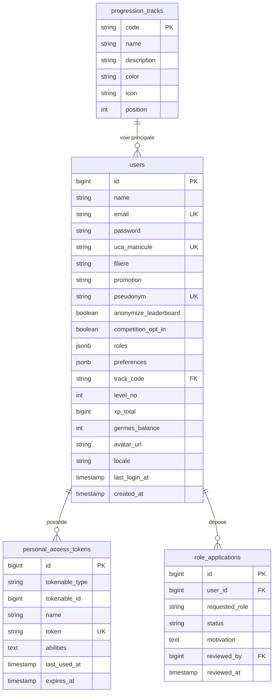

#### Domaine 2 : Quêtes, Étapes & Soumissions

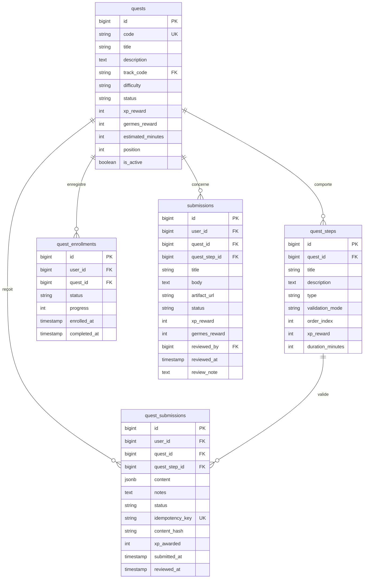

#### Domaine 3 : Journaux Immuables (XP & Germes Ledgers)

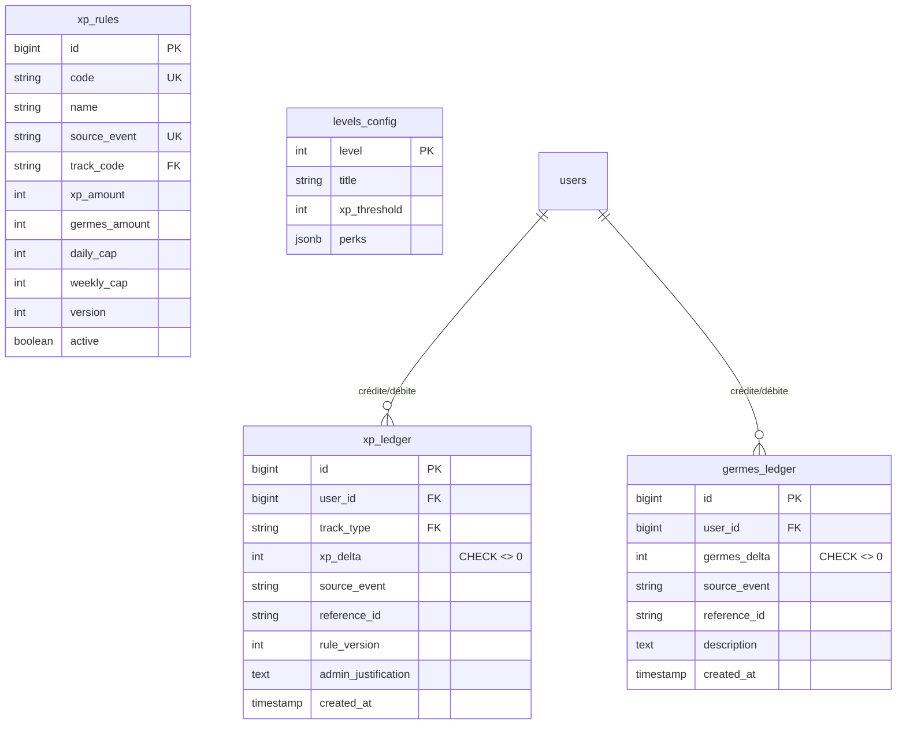

#### Domaine 4 : Boutique, Commandes & Économie

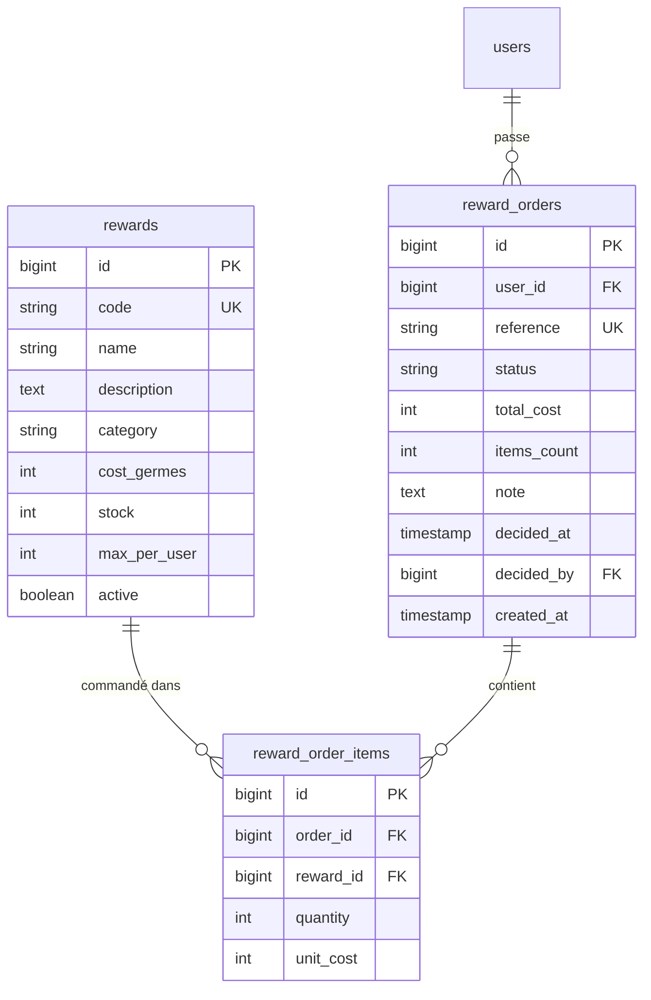

#### Domaine 5 : La Forge (Entraide & Modération)

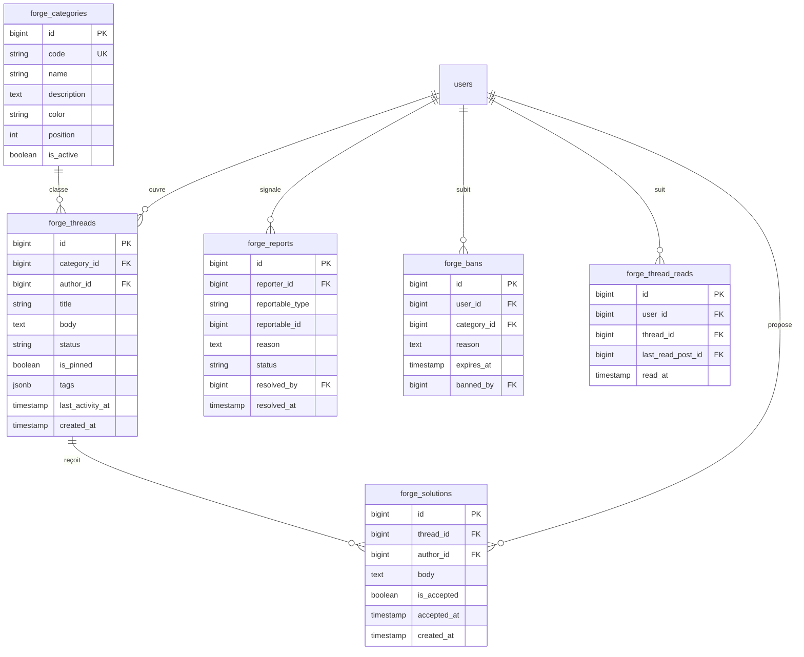

#### Domaine 6 : Badges, Missions, Défis & Audit

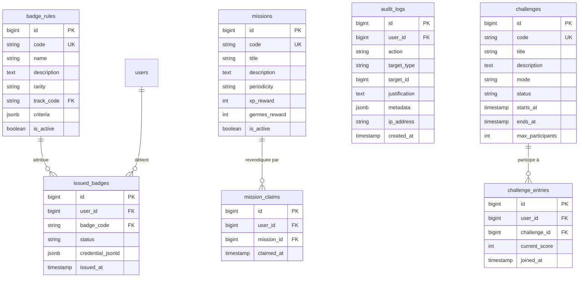

---

### 7.2 Tables & Colonnes Nouvelles ou Modifiées Requises

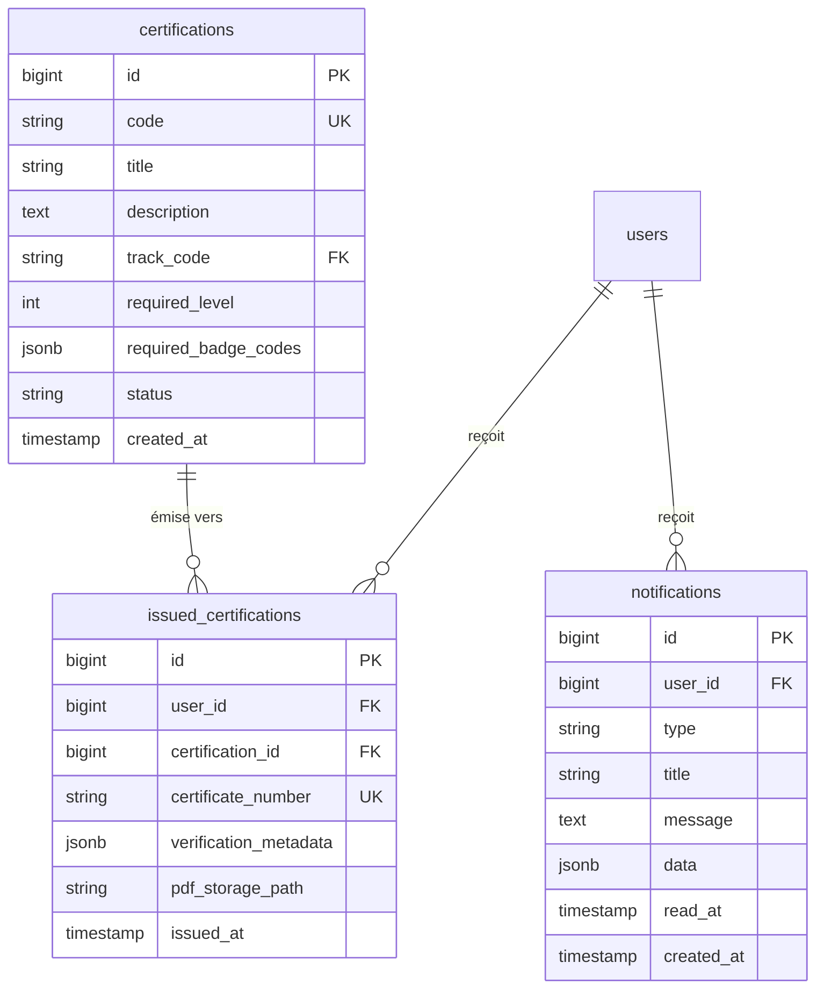

#### Détail des ajouts et modifications recommandés

| Table / Colonne | Type d'Opération | Motif / Fonctionnalité Cible | Spécifications Techniques |
|---|:---:|---|---|
| **`certifications`** | **NEW TABLE** | Résoudre le 404 sur `GET /certifications` et stocker le référentiel des 4 attestations | `id`, `code` (UK), `title`, `description`, `track_code` (FK), `required_level`, `required_badge_codes` (jsonb), `status`, timestamps. |
| **`issued_certifications`** | **NEW TABLE** | Tracer les certificats attribués aux apprenants avec preuve et PDF | `id`, `user_id` (FK), `certification_id` (FK), `certificate_number` (UK), `pdf_storage_path` (nullable), `issued_at`. Contrainte UNIQUE `(user_id, certification_id)`. |
| **`notifications`** | **NEW TABLE** | Système de notifications in-app pour validation de quête, achat boutique, modération | `id`, `user_id` (FK, index), `type`, `title`, `message`, `data` (jsonb), `read_at` (nullable, index), `created_at`. |
| **`forge_votes`** | **MODIFICATION** | Supporter les likes de sujets (actuellement rejetés en 501) | Ajouter `vote_target_type` ('thread', 'solution') et `vote_target_id` pour unifier les votes sur les sujets et réponses. |
| **`users.roles`** | **INDEXATION** | Performance de filtrage des rôles sous forte concurrence | Ajouter un index GIN PostgreSQL : `CREATE INDEX users_roles_gin ON users USING gin (roles);` |
| **`submissions` / `quest_submissions`** | **UNIFICATION** | Supprimer la dualité déroutante entre les deux tables de soumissions | Ajouter une vue ou consolider `submissions` pour les livrables libres formateur et `quest_submissions` pour les quiz/étapes. |

### 7.3 Liste des Nouvelles Migrations en Ordre de Dépendance

1. `2026_11_25_000001_create_certifications_and_issued_tables.php` (Dépend de `users` et `progression_tracks`)
2. `2026_11_25_000002_create_notifications_table.php` (Dépend de `users`)
3. `2026_11_25_000003_extend_forge_votes_for_threads.php` (Dépend de `forge_threads` et `forge_votes`)
4. `2026_11_25_000004_add_gin_indexes_on_jsonb_columns.php` (Indexe `users.roles`, `users.preferences`, `quest_submissions.content`)

---

## 8. Pipelines de Correction des Flux Critiques

### 8.1 Pipeline 1 : Dépôt de Livrable → Validation Formateur → Gain XP & Badge

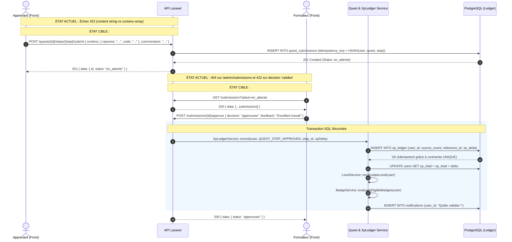

### 8.2 Pipeline 2 : Achat en Boutique (Atomique & Idempotent)

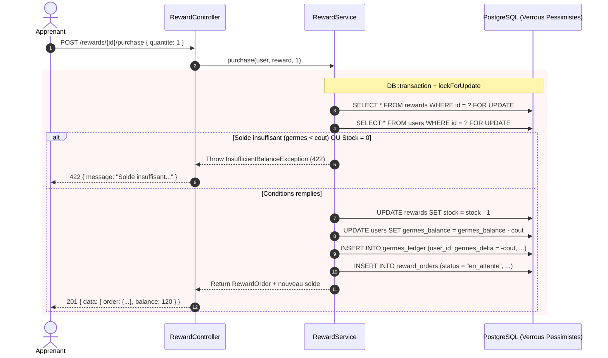

### 8.3 Pipeline 3 : Authentification & Connexion SSO UCA

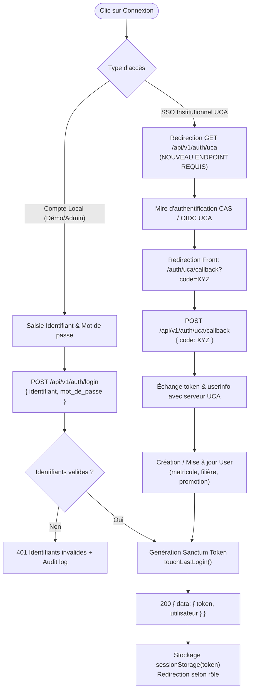

---

## 9. Analyse d'Aptitude à la Production (Échelle de Charge)

Évaluation des risques pour supporter plusieurs centaines d'étudiants simultanés :

| Domaine | Risque Identifié | Impact | Sévérité | Preuve / Fichier | Remédiation Recommandée |
|---|---|---|:---:|---|---|
| **Contrat API** | Mismatch intégral des clés et de l'enveloppe `{data}` | Crash immédiat de l'UI à l'ouverture de chaque page | **CRITIQUE** | `api.ts`, `UserProfileResource.php` | Mettre en place un adaptateur bidirectionnel ou uniformiser les `JsonResource` sur le schéma TypeScript. |
| **Build & CI** | Échec de compilation TypeScript sur 2 pages | Déploiement en production impossible | **CRITIQUE** | `director-overview-page.tsx:12`, `director-identity-page.tsx:3` | Supprimer les imports inutilisés (`IdentityCard`, `ShoppingBag`). |
| **Tests & QA** | 2 erreurs de syntaxe PHP bloquant PHPUnit | Zéro test exécutable, régressions non détectables | **CRITIQUE** | `ExampleTest.php:35`, `LedgerIdempotencyTest.php:69` | Corriger les espaces dans les noms de fonctions. |
| **Authentification** | Pas de révocation de jeton Sanctum au logout | Jetons orphelins persistants, risque de vol de session | **ÉLEVÉE** | `auth.tsx:201` | Appeler `POST /api/v1/auth/logout` dans le callback `logout()`. |
| **Authentification** | URL `/api/v1/auth/login` codée en dur dans `auth.tsx` | Impossible de pointer sur un domaine API externe en prod | **ÉLEVÉE** | `auth.tsx:166` | Utiliser `API_BASE_URL` au lieu du chemin absolu relatif. |
| **Sécurité / RBAC** | Écrans de modération et gouvernance en `localStorage` | Aucune traçabilité réelle des sanctions directeur/modérateur | **ÉLEVÉE** | `director-forge-page.tsx:14` | Relier les boutons aux endpoints `ModerationAdminController`. |
| **Performance DB** | N+1 queries potentielles sur les calculs de progression | Saturations PostgreSQL lors des pics de connexion (amphi) | **ÉLEVÉE** | `LevelService.php:50`, `DashboardService.php:33` | Eager loading sur `questEnrollments.quest`, indexation GIN sur `users.roles`. |
| **Performance DB** | Calcul en temps réel du classement par `SUM(xp_delta)` | Ralentissement exponentiel sous 500+ étudiants actifs | **MOYENNE** | `LeaderboardService.php:38` | Mettre en cache Redis (`Cache::remember`) le classement pendant 60 secondes. |
| **Ops & Déploiement** | Absence de fichier `docker-compose.yml` de production | Déploiements hétérogènes, divergences de versions PHP/PG | **MOYENNE** | Racine du projet | Créer un `docker-compose.yml` multi-conteneurs (PHP-FPM, Nginx, PostgreSQL 18, Redis). |
| **Fiabilité File** | Traitement synchrone des tâches (mail, audit, badges) | Temps de réponse HTTP élevés lors de la validation | **MOYENNE** | `config/queue.php` (`QUEUE_CONNECTION=sync`) | Configurer Redis pour les workers de queue asynchrones en production. |
| **Réglementaire** | Badges non signés (Open Badges 3.0 incomplet) | Risque de falsification des attestations étudiantes | **FAIBLE** | `README.md:96`, `BadgeController.php:56` | Conserver la mention visible "Attestation non signée" en attendant l'infrastructure DID. |

---

## 10. Backlog Priorisé & Format Prêt-à-l'Emploi GitHub Issues

Le backlog est structuré pour permettre un copier-coller immédiat ou un import automatisé dans **GitHub Issues / GitHub Projects**.

### 10.1 Légende des Labels & Milestones

- **Labels de priorité :** `priority:P0` (bloque la prod), `priority:P1` (haute), `priority:P2` (moyenne), `priority:P3` (basse)
- **Labels d'espace :** `workspace:student`, `workspace:admin`, `workspace:trainer`, `workspace:moderator`, `workspace:director`, `workspace:auth`
- **Labels de domaine :** `area:api`, `area:web`, `area:db`, `area:ops`
- **Labels de type :** `type:feat`, `type:fix`, `type:chore`
- **Milestones :**
  - `Milestone 0 : Socle & Santé Technique` (Semaine 0 - Sprint 1)
  - `Milestone 1 : Tranche Verticale Économie & Quêtes` (Sprint 1)
  - `Milestone 2 : Pédagogie & Validation Formateur` (Sprint 2)
  - `Milestone 3 : Communauté & Compétition (Forge & Arène)` (Sprint 3)
  - `Milestone 4 : Production & Industrialisation` (Sprint 4)

---

### 10.2 Fiches d'Issues GitHub Prêtes à l'Emploi (P0 & P1)

#### Issue #1 — [FIX-P0] Résolution des erreurs de syntaxe PHP et exécution des tests PHPUnit
- **Labels :** `priority:P0`, `area:api`, `area:db`, `type:fix`
- **Milestone :** `Milestone 0 : Socle & Santé Technique`
- **Assigné :** Stagiaire A (Backend)
- **Description :**
  Deux méthodes de test contiennent un espace accidentel dans leur nom, ce qui provoque une erreur fatale de parsing PHP (code 255) dès que PHPUnit inspecte la suite de tests :
  1. `apps/api/tests/Unit/ExampleTest.php:35` : `les_voies_de_progression_sont_au nombre_de_quatre()`
  2. `apps/api/tests/Feature/LedgerIdempotencyTest.php:69` : `une_ correction_se_fait_par_ecriture_compensatoire()`
  De plus, corriger le nom de classe et de fichier `Codep212ConfigService` en `Code212ConfigService` pour éliminer la faute de frappe propagée.
- **Critères d'acceptation :**
  - [ ] `php -l tests/Unit/ExampleTest.php` et `tests/Feature/LedgerIdempotencyTest.php` réussissent sans erreur.
  - [ ] `php artisan test --testsuite=Unit` s'exécute et passe au vert.
  - [ ] Les 8 tests Feature s'exécutent avec succès sur PostgreSQL.

#### Issue #2 — [FIX-P0] Résolution des erreurs de compilation TypeScript dans l'espace Direction
- **Labels :** `priority:P0`, `workspace:director`, `area:web`, `type:fix`
- **Milestone :** `Milestone 0 : Socle & Santé Technique`
- **Assigné :** Stagiaire C (Admin/Ops)
- **Description :**
  La compilation TypeScript `tsc -b` échoue avec l'erreur `TS6133: declared but its value is never read` en raison de la règle stricte `noUnusedLocals: true` :
  1. `apps/web/src/pages/director/director-identity-page.tsx:3` : import inutilisé `IdentityCard`.
  2. `apps/web/src/pages/director/director-overview-page.tsx:12` : import inutilisé `ShoppingBag`.
- **Critères d'acceptation :**
  - [ ] Les imports inutilisés sont nettoyés.
  - [ ] `cd apps/web && npx tsc --noEmit` se termine sans aucune erreur.
  - [ ] `npm run build` génère le bundle de production `dist/` sans avertissement bloquant.

#### Issue #3 — [FIX-P0] Déballage universel de l'enveloppe `{ data, meta }` dans le client HTTP
- **Labels :** `priority:P0`, `area:web`, `type:fix`
- **Milestone :** `Milestone 0 : Socle & Santé Technique`
- **Assigné :** Stagiaire B (Frontend)
- **Description :**
  Le client `request()` dans `apps/web/src/services/api.ts:48` retourne directement `await response.json()`. Lorsque Laravel renvoie `{ "data": [...], "meta": {...} }`, les composants React recevant cet objet lèvent des `TypeError: .map is not a function`.
- **Critères d'acceptation :**
  - [ ] `request()` extrait automatiquement la clé `data` si la réponse contient une enveloppe racine `{ data: ... }`.
  - [ ] Si `meta` est présent (pagination), l'attacher ou le propager proprement.
  - [ ] Toutes les requêtes `api.quests()`, `api.badges()`, etc. reçoivent directement le tableau exploitable.

#### Issue #4 — [FEAT-P0] Création de la Tranche Verticale Quête : Dépôt & Validation
- **Labels :** `priority:P0`, `workspace:student`, `workspace:trainer`, `area:api`, `area:web`, `type:feat`
- **Milestone :** `Milestone 1 : Tranche Verticale Économie & Quêtes`
- **Assignés :** Stagiaire A (API) & Stagiaire B (Web)
- **Description :**
  Rétablir la chaîne complète de soumission d'étape de quête :
  1. Frontend : envoyer `{ contenu: { reponse: content }, commentaire: "" }` au lieu de `{ content: string }` pour satisfaire `SubmitStepRequest.php:25`.
  2. API : mapper `QuestSubmissionResource` avec des clés compréhensibles par le frontend (`xpAwarded`, `status`).
  3. Validation formateur : rediriger `adminSubmissions()` vers `GET /api/v1/submissions` et `reviewSubmission()` vers `POST /api/v1/submissions/{id}/approve` avec le statut `'approuvee'`.
- **Critères d'acceptation :**
  - [ ] Un étudiant connecté peut soumettre une étape depuis `quest-detail-page.tsx` sans erreur 422.
  - [ ] Le formateur voit la production en attente dans `admin-validation-page.tsx`.
  - [ ] L'approbation crédite le ledger XP de façon idempotente et notifie l'interface.

#### Issue #5 — [FEAT-P0] Création de l'Entité et de l'Endpoint `/certifications`
- **Labels :** `priority:P0`, `workspace:student`, `area:api`, `area:db`, `type:feat`
- **Milestone :** `Milestone 2 : Pédagogie & Validation Formateur`
- **Assigné :** Stagiaire A (Backend)
- **Description :**
  L'écran `certifications-page.tsx` tente d'appeler `GET /api/v1/certifications` qui n'existe nulle part dans le backend. Créer la migration, le modèle `Certification`, le seeder (les 4 attestations du centre) et le contrôleur associé.
- **Critères d'acceptation :**
  - [ ] Migration `create_certifications_table` exécutée avec succès.
  - [ ] `GET /api/v1/certifications` renvoie le catalogue des 4 certifications (Open Badges).
  - [ ] L'écran frontend affiche les critères et les badges prérequis sans erreur réseau.

#### Issue #6 — [FIX-P0] Normalisation des Ressources JSON Profil et Tableau de Bord
- **Labels :** `priority:P0`, `workspace:student`, `workspace:admin`, `area:api`, `type:fix`
- **Milestone :** `Milestone 1 : Tranche Verticale Économie & Quêtes`
- **Assigné :** Stagiaire A (Backend)
- **Description :**
  `UserProfileResource.php` et `DashboardService.php` renvoient des clés en français (`nom`, `niveau`, `germes`, `progression`, `quetes`), alors que le frontend attend de l'anglais camelCase (`firstName`, `level`, `germs`, `activeQuests`, `weeklyActivity`).
- **Critères d'acceptation :**
  - [ ] Les ressources API exposent les clés camelCase conformes au contrat TypeScript, ou un convertisseur est intégré dans la façade API.
  - [ ] La page `/profile` et la page `/` (Dashboard) affichent les vraies données utilisateur sans champ `undefined`.

#### Issue #7 — [FEAT-P1] Conteneurisation Docker multi-services et Setup en 10 minutes
- **Labels :** `priority:P1`, `area:ops`, `type:feat`
- **Milestone :** `Milestone 0 : Socle & Santé Technique`
- **Assigné :** Stagiaire C (Admin/Ops)
- **Description :**
  Fournir un `docker-compose.yml` complet à la racine du dépôt pour permettre à n'importe quel développeur ou testeur de monter l'environnement complet (PostgreSQL 18, Redis, PHP-FPM 8.3/8.5, Nginx, Node) en une commande `docker compose up -d`.
- **Critères d'acceptation :**
  - [ ] `docker compose up -d` monte la base de données, applique les migrations et les seeders automatiquement.
  - [ ] Le frontend est accessible sur `http://localhost:5173` et communique avec `http://localhost:8000/api/v1`.

---

## 11. Questions Ouvertes pour le Responsable du Centre CODE212

Pour arbitrer les choix laissés en suspens dans la documentation et finaliser l'implémentation :

1. **Économie : Devise unique ou dualité permanente ?**
   - *Contexte :* La documentation sépare strictement l'XP (permanent, niveau) et les Germes (dépensables).
   - *Question :* Confirmez-vous que les dépenses en boutique ne doivent **jamais** impacter le niveau d'un étudiant (aucun déclassement possible suite à un achat) ?
2. **Droit de vote dans La Forge : Niveau 3 ou Niveau 4 ?**
   - *Contexte :* `DECISIONS.md:169` hésite entre le niveau 4 et le statut « Résident Actif » niveau 3.
   - *Question :* Quel palier minimum de niveau doit débloquer la possibilité de voter (liker) et d'approuver une solution d'entraide ?
3. **Identité de l'Émetteur Open Badges 3.0 :**
   - *Contexte :* Les preuves JSON-LD actuelles ne comportent pas de signature cryptographique VC-JWT.
   - *Question :* L'université dispose-t-elle déjà d'une clé publique institutionnelle (DID) pour signer les attestations, ou doit-on maintenir le statut "Attestation non signée" certifiée en base locale pour la V1 ?
4. **Politique d'Identité & Modération :**
   - *Contexte :* `admin-moderation-page.tsx` prévoit des bannissements temporaires.
   - *Question :* Quels sont les motifs officiels et les durées types de bannissement ? Les formateurs ont-ils délégation pour bannir ou seul le Directeur du Centre peut-il prononcer une exclusion ?
5. **Intégration Libki (Présence physique) :**
   - *Contexte :* La table `libki_sync_logs` existe, mais l'API Libki n'est pas connectée.
   - *Question :* CODE212 souhaite-t-il attribuer de l'XP automatique lors du check-in aux postes informatiques dès la V1, ou cette synchronisation doit-elle faire l'objet d'un lot V2 ?
6. **Infrastructure et Hébergement Cible :**
   - *Contexte :* Nécessité de dimensionner PostgreSQL et Redis.
   - *Question :* L'application sera-t-elle hébergée sur des serveurs dédiés UCA (on-premise) ou sur une infrastructure cloud externe ? Dispose-t-on d'un serveur Redis dédié ?

---

## 12. Annexe Technique

### 12.1 Inventaire Sommaire des Fichiers Clés

```
Frontend (apps/web) :
- src/App.tsx : Routeur principal (26 routes déclarées réparties sur 5 espaces)
- src/main.tsx : Point d'entrée avec ThemeProvider et MotionConfig reducedMotion
- src/hooks/use-api.ts : 28 hooks TanStack Query (queries et mutations)
- src/services/api.ts : Façade réseau (bascule mock/http, client fetch)
- src/services/mock/server.ts : Moteur de simulation répliquant les règles métiers
- src/types/index.ts : 23 interfaces métiers en anglais camelCase

Backend (apps/api) :
- routes/api.php : 54 routes /api/v1 protégées par Sanctum, throttling et rôles
- app/Http/Controllers/Api/V1/ : 16 contrôleurs métier + 5 contrôleurs Admin
- app/Http/Resources/ : 22 ressources JSON sérialisant en français snake_case
- app/Http/Requests/ : 19 FormRequests validant les entrées
- app/Services/ : 13 services métier transactionnels
- app/Models/ : 35 modèles Eloquent
- database/migrations/ : 36 migrations PostgreSQL (contraintes CHECK et triggers append-only)
- tests/Feature/ : 8 tests d'invariants métier
```

### 12.2 Extraits de Sorties de Commandes

```bash
# Vérification du build frontend
$ cd apps/web && npm run build
> @code212/web@0.6.0 build
> tsc -b && vite build
src/pages/director/director-identity-page.tsx:3:1 - error TS6133: 'IdentityCard' is declared but its value is never read.
src/pages/director/director-overview-page.tsx:12:3 - error TS6133: 'ShoppingBag' is declared but its value is never read.
Found 2 errors.

# Vérification syntaxique PHP
$ cd apps/api && find app config database routes tests -name "*.php" -exec php -l {} \; | grep -v "No syntax errors"
PHP Parse error:  syntax error, unexpected identifier "nombre_de_quatre", expecting "(" in tests/Unit/ExampleTest.php on line 35
PHP Parse error:  syntax error, unexpected identifier "correction_se_fait_par_ecriture_compensatoire", expecting "(" in tests/Feature/LedgerIdempotencyTest.php on line 69

# Vérification du routeur Laravel
$ php artisan route:list --path=api/v1 --json | grep -o '"uri":' | wc -l
54
```

---

## 13. Workflow d'Équipe & Stratégie Git (3 Stagiaires, 1 Superviseur)

### 13.1 Modèle de Branches : Trunk-Based Development Court

Pour un monorepo à 3 développeurs, le modèle **Trunk-Based Development** avec branches éphémères (durée de vie **1 à 2 jours maximum**) est prescrit en remplacement de tout modèle lourd type Git Flow.

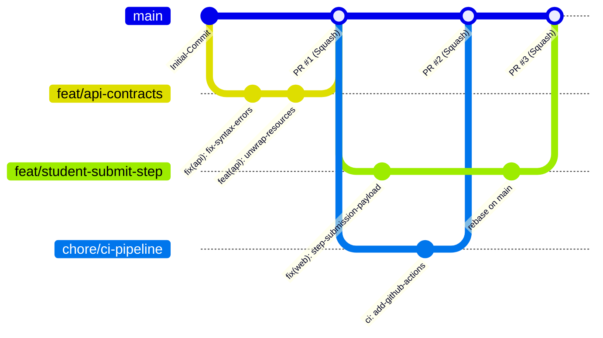

#### Règles de Protection de la Branche `main` sur GitHub
- **Require a pull request before merging** : Interdiction absolue de push direct sur `main`.
- **Require approvals** : Minimum **1 approbation** par un pair pour toute PR. L'approbation du superviseur est **obligatoire** pour toute PR touchant `database/migrations/` ou les règles XP (`xp_ledger`).
- **Require status checks to pass** : Le build frontend (`npm run build`) et les tests backend (`php artisan test`) doivent être obligatoirement au vert avant déblocage du bouton de merge.
- **Require linear history / Squash and merge** : Chaque PR est fusionnée en un commit unique nettoyé sur `main` afin de conserver un historique lisible et bisectable.
- **Do not allow force pushes** : Protection activée sur `main`.

#### Conventions de Nommage des Branches
- `feat/<workspace>-<description-courte>` (ex: `feat/student-certifications`)
- `fix/<area>-<description-courte>` (ex: `fix/api-submit-step-422`)
- `chore/<topic>` (ex: `chore/docker-compose-setup`)
- `docs/<topic>` (ex: `docs/api-contract-alignment`)

---

### 13.2 Hotspots de Conflits & Règles d'Ownership Monorepo

| Fichier / Zone Critique | Risque de Conflit | Règle d'Ownership & Découpage Préventif | Responsable Principal |
|---|:---:|---|---|
| `routes/api.php` | **ÉLEVÉ** | **Découpage modulaire** : Découper `routes/api.php` en sous-fichiers inclus (`routes/api/auth.php`, `routes/api/student.php`, `routes/api/admin.php`). | Stagiaire A |
| `apps/web/src/services/api.ts` | **TRÈS ÉLEVÉ** | **Scission par domaine** : Décomposer `api.ts` en `services/api/student.ts`, `services/api/admin.ts`, `services/api/forge.ts` et réexporter depuis un index unique. | Stagiaire B |
| `apps/web/src/hooks/use-api.ts` | **ÉLEVÉ** | Décomposer en `hooks/use-quests.ts`, `hooks/use-admin.ts`, `hooks/use-forge.ts`. | Stagiaire B |
| `apps/web/src/types/index.ts` | **ÉLEVÉ** | Découper par domaine : `types/user.ts`, `types/quest.ts`, `types/admin.ts`. | Stagiaire B |
| `database/migrations/` | **CRITIQUE** | **Règle absolue : Forward-only**. Chaque migration porte le timestamp de création de branche. Ne jamais modifier une migration existante. | Stagiaire A |
| `package-lock.json` | **MOYEN** | Uniquement modifié lors de l'ajout d'une nouvelle dépendance validée en daily. Ne jamais résoudre les conflits à la main (`npm install`). | Stagiaire B / C |
| `composer.lock` | **MOYEN** | Résolution stricte via `composer update <package> --with-dependencies`. | Stagiaire A |

---

### 13.3 Pipeline d'Intégration Continue (GitHub Actions)

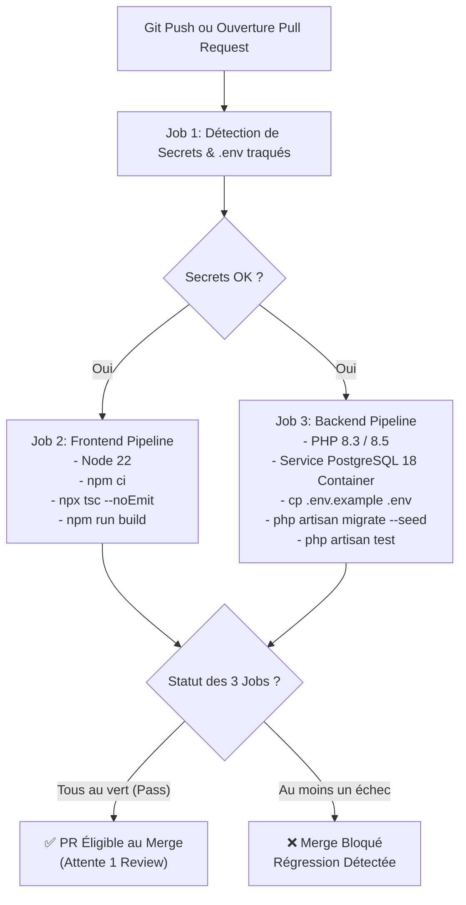

> **État actuel vs Cible :**
> - *Actuel :* Aucun dossier `.github/` ni fichier CI n'existe dans le dépôt.
> - *Cible :* Fichier template prêt à l'emploi rédigé à `.agents/context/templates/ci.yml`.

---

### 13.4 Sécurité & Hygiène Git (Statut Détecté)

- **Audit des fichiers traqués :** Aucun fichier `.env` ou clé privée n'est actuellement suivi dans le dépôt Git (vérifié par `git ls-files | grep -E "(\.env|secret|key)"`). Seuls `.env.example` sont versionnés.
- **Règle d'hygiène stricte :** Le fichier `.gitignore` racine ignore correctement `.env`, `.env.local`, `apps/api/.env`, `apps/api/storage/*.key`.
- **Règle P0 en cas de fuite :** Si un stagiaire committe accidentellement un secret, ne **jamais** écraser l'historique sur `main` sans concertation : révoquer immédiatement la clé/mot de passe côté serveur, puis nettoyer l'historique via `git-filter-repo`.

---

### 13.5 Rythme d'Équipe & Définition du Prêt (DoD)

- **Daily Sync (15 minutes chaque matin à 9h30) :**
  1. Qu'est-ce que j'ai mergé hier ?
  2. Que vais-je merger aujourd'hui ?
  3. Quels sont mes bloqueurs ou risques de conflits ?
- **Démo Hebdomadaire (Vendredi 16h) :**
  - Présentation directe sur environnement réel (`VITE_USE_MOCK=false`) au superviseur du Centre CODE212.
  - Zéro démo sur maquette ou mock.
- **Definition of Done (DoD) pour valider une Issue :**
  1. Le code compile sans avertissement bloquant (`tsc -b` et `php -l`).
  2. Les tests automatisés passent (`php artisan test`).
  3. La fonctionnalité est testée et validée de bout en bout en mode connecté (`VITE_USE_MOCK=false`).
  4. La documentation et les contrats d'API ont été mis à jour.
  5. 1 review approuvée par un pair (+ superviseur si base de données).

---

### 13.6 Checklist du Premier Jour pour l'Équipe

- [ ] **Étape 1 :** Configurer les accès au dépôt GitHub pour les 3 stagiaires et le superviseur.
- [ ] **Étape 2 :** Activer la protection de la branche `main` (Branch Protection Rule : require PR, 1 approval, require status checks).
- [ ] **Étape 3 :** Créer les labels (`priority:P0..P3`, `workspace:*`, `area:*`, `type:*`) et initialiser le projet GitHub Projects (colonnes : *Backlog*, *En cours*, *En revue*, *Terminé*).
- [ ] **Étape 4 :** Copier les fichiers depuis `.agents/context/templates/` vers `.github/` (`workflows/ci.yml`, `pull_request_template.md`, etc.).
- [ ] **Étape 5 :** Valider l'environnement local de chaque stagiaire : clone, exécution des conteneurs/serveurs locaux, vérification que `npm run build` et `php artisan route:list` répondent.

---

## 14. Plan de Démarrage & Séquencement des Travaux

### 14.1 Recommandation de la Première Fonctionnalité Clé

> **LA PREMIÈRE TRANCHE VERTICALE RECOMMANDÉE :**  
> **"Dépôt d'étape de quête par l'apprenant → Notification de soumission → Validation par le formateur → Attribution idempotente d'XP dans le Ledger"**

#### Justification Basée sur les Preuves de l'Audit :
1. C'est le **cœur de métier absolu** de la plateforme CODE212 Quest : tout le système (niveaux, badges, déblocage des parcours) découle de cette validation.
2. C'est là que réside le plus grand nombre d'invariants critiques (idempotence de la clé `(user_id, quest_id, step_id)`, verrou de ligne, trigger PostgreSQL append-only).
3. Elle connecte immédiatement deux espaces fondamentaux : l'**Espace Apprenant** (`quest-detail-page.tsx`) et l'**Espace Formateur** (`admin-validation-page.tsx`).

#### Ce qui doit être vrai AVANT de commencer cette tranche :
- [x] Les erreurs de syntaxe PHP doivent être corrigées (Issue #1).
- [x] Le déballage de l'enveloppe `{ data }` dans `api.ts` doit être actif (Issue #3).
- [x] La base PostgreSQL locale ou sous Docker doit être accessible et migrée.

#### Risques associés :
- Risque de régression sur les triggers append-only si un développeur tente de faire un `UPDATE` sur `xp_ledger`.
- Conflit entre les tables `quest_submissions` et `submissions` (nécessite l'alignement sur `quest_submissions`).

---

### 14.2 Ce qu'il NE FAUT PAS Commencer Maintenant (Liste d'Exclusion Temporaire)

| Fonctionnalité | Motif du Report | Déblocage Prévu |
|---|---|---|
| **Connexion SSO OIDC UCA réelle** | Dépend des identifiants et client_secret de l'université (non encore fournis). Utiliser le login mot de passe local/Sanctum. | Sprint 3 |
| **Synchronisation de Présence Libki** | Aucun contrôleur ni webhook n'existe ; disponibilité de l'API Libki non confirmée par le centre. | Sprint 4 |
| **Signature Open Badges 3.0 (VC-JWT / DID)** | L'infrastructure d'émetteur institutionnel n'est pas définie. Maintenir les attestations non signées locales. | Sprint 4 |
| **Version Arabe / RTL** | Risque de dispersion sur l'ergonomie alors que la plomberie fonctionnelle est rompue. | Post-V1 |
| **Export PDF complexe des attestations** | Fonctionnalité périphérique non bloquante pour l'apprentissage. | Sprint 3 |

---

### 14.3 Feuille de Route Semaine 0 à Sprint 3 (Attribution par Stagiaire)

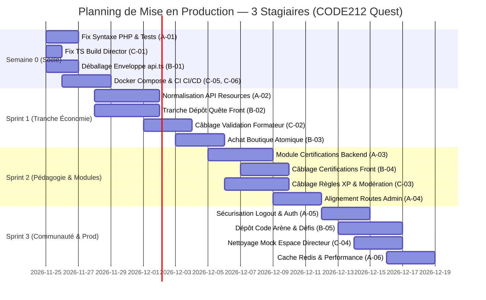

### 14.4 Diagramme de Dépendances des Tâches Initiales

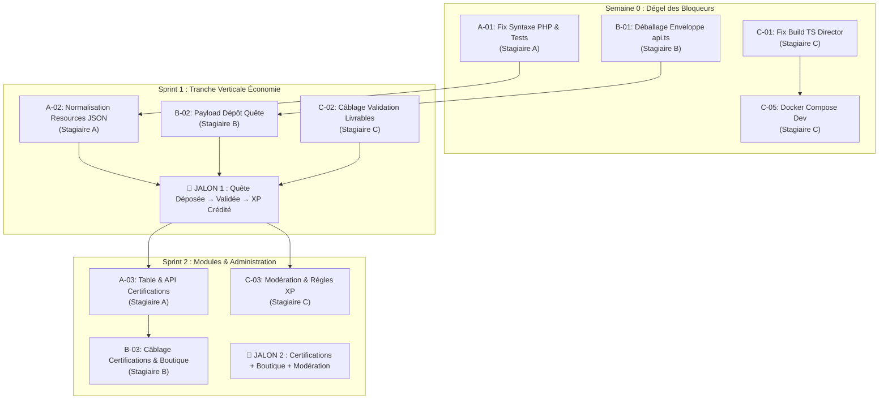

---
*Fin du rapport d'audit technique et guide de cadrage opérationnel — Code212 Quest V1.0.*
